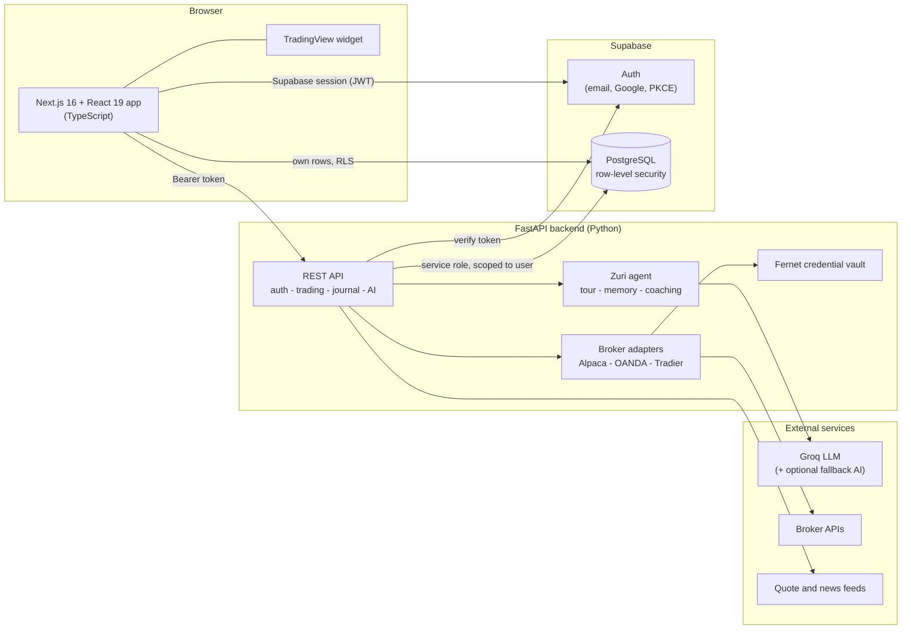
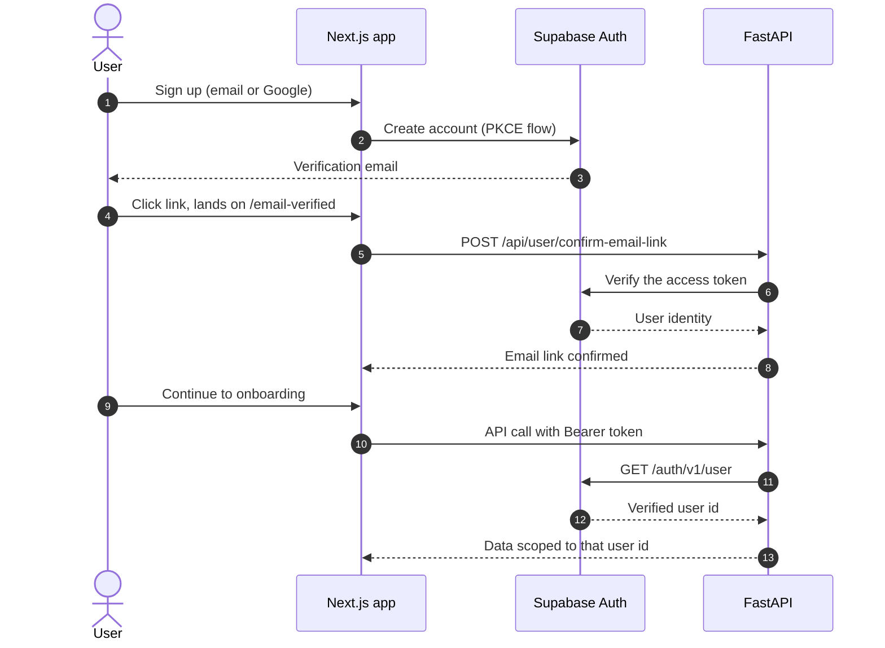
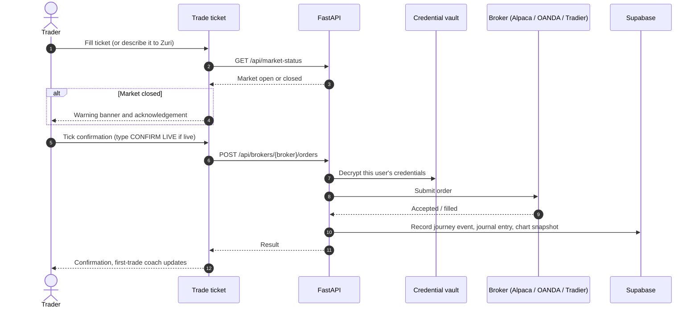
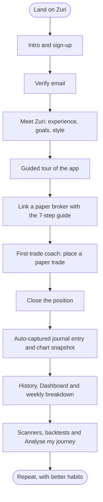

<div align="center">


# Zuri Markets

**An AI-guided trading desk that teaches new traders by doing: paper-trade first, journal everything, learn from your own habits.**


</div>

---

## Table of contents

1. [Project overview](#1-project-overview)
2. [Features](#2-features)
3. [Architecture and diagrams](#3-architecture-and-diagrams)
4. [Technologies used](#4-technologies-used)
5. [Installation and setup](#5-installation-and-setup)
6. [Environment variables](#6-environment-variables)
7. [Usage guide](#7-usage-guide)
8. [UI mockups](#8-ui-mockups)
9. [Security](#9-security)
10. [Testing and quality](#10-testing-and-quality)
11. [Project structure](#11-project-structure)
12. [API reference](#12-api-reference)
13. [Known limitations](#13-known-limitations)
14. [Troubleshooting](#14-troubleshooting)

---

## 1. Project overview

### Purpose

Most trading platforms assume you already know what you are doing. New traders are handed a dense screen, a live-money button and no feedback, and most of them learn expensive lessons alone.

**Zuri Markets** is a personal trading desk built around the opposite idea: the platform should coach you. An AI guide named **Zuri** meets each new user, finds out their experience and goals, walks them through the whole app, helps them link a free **paper-trading** (practice) broker account, coaches them through a first trade, and then keeps an honest record of what they did so it can point out their own habits, good and bad.

### Who it is for

| Audience | What Zuri gives them |
|---|---|
| **Brand-new traders** | A guided tour, a step-by-step broker setup, a first-trade coach and free learning resources chosen for their level. |
| **Developing traders** | An automatic journal, a "leak finder" that spots patterns such as trades without a stop-loss, and chart snapshots to review. |
| **Experienced traders** | A fast trade ticket, scanners, historical signal reviews and a terse assistant that does not over-explain. |

### What makes it different

- **Practice first.** Onboarding steers users to a paper account. Live accounts are supported but gated behind an explicit `CONFIRM LIVE` phrase.
- **The AI never trades for you.** Zuri can propose and explain, but every order needs your explicit confirmation.
- **Your journal writes itself.** Every order placed through Zuri, and every position opened outside it, is captured with a chart snapshot.
- **Honest numbers.** Results are labelled as estimates where they are estimates, and the AI is told to use only the figures it is given.
- **Your data, your account.** Everything is stored per user in Supabase behind row-level security. Broker credentials are encrypted and never returned to the browser.

---

## 2. Features

### Onboarding and guidance
- **Email and Google sign-up** with email verification and a branded confirmation page.
- **"Meet Zuri"** onboarding chat that learns the user's experience, goals and preferred style (Training buddy or Assistant).
- **Guided tour** of the app (33 steps) that highlights real parts of the screen.
- **Broker setup guide**: a 7-step walkthrough for creating Alpaca paper keys. It jumps to the final step by itself once the broker is linked.
- **First-trade coach** that tracks progress from "link a broker" to "first trade done".
- **Persistent memory**: Zuri remembers what the user understands and how they like things explained. Users can view or reset it.

### Trading
- **Trade ticket** with market and limit orders, stop-loss and take-profit, and position sizing against account risk.
- **Conversational trading**: describe a trade in plain English and Zuri parses it into a ticket for you to review.
- **Multi-broker**: **Alpaca** (stocks and crypto), **OANDA** (forex) and **Tradier** (stocks), paper or live.
- **Closed-market warning** before an order is sent while the market is shut, with the right acknowledgement for brokers that queue orders.
- **Pending orders** you can list and cancel, and **Close position** / **Close all**.
- **Safety gates**: a confirmation checkbox on every order and a typed `CONFIRM LIVE` phrase for live accounts.

### Charts and research
- **Live TradingView chart** with a watchlist and real quotes.
- **Market briefing** from CNBC and BBC feeds, with a one-click "Ask Zuri" on any story.
- **AI scanners**: describe a rule ("alert me when BTCUSD RSI crosses above 70"), review the draft, then activate it. Supports price breakouts, moving-average crosses and RSI levels.
- **Historical signal review (backtests)** on real broker candles, with a custom date range of up to five years.
- Scanners and backtest history are **saved to your account** and sync across devices.

### Review and learning
- **Dashboard** with balance, an AI "best next move" card, a weekly activity breakdown and free courses chosen for the user's level.
- **History**: closed trades, orders and open positions from the broker, with CSV export.
- **Chart snapshots** of every entry and exit with entry, stop and target lines. Zuri annotates support, resistance and stop placement, and offers a **practice mode** that hides the annotations until revealed.
- **Journal**: auto-captured entries plus your own notes, an AI-written note for any trade, and **Analyse my journey** for a leak and strategy report.

### Account and security
- Settings for **Account, Broker, Trading, Risk, Platform, Display and Security**.
- Password reset, email change, and permanent **account deletion**.

---

## 3. Architecture and diagrams

### 3.1 System architecture



**How to read it:** the browser talks to Supabase directly for sign-in and for the user's own simple data (protected by row-level security), and to the FastAPI backend for everything that needs secrets, broker access or AI. The backend never trusts the browser: it verifies every token with Supabase and scopes every query to that user.

### 3.2 Authentication flow



### 3.3 Placing an order



### 3.4 The new-trader journey



### 3.5 Data model

```mermaid
erDiagram
    AUTH_USERS ||--|| PROFILES : has
    AUTH_USERS ||--|| USER_PREFERENCES : has
    AUTH_USERS ||--o{ WATCHLIST_ITEMS : owns
    AUTH_USERS ||--o{ JOURNAL_ENTRIES : writes
    AUTH_USERS ||--o{ BROKER_CONNECTIONS : links
    AUTH_USERS ||--|| ZURI_JOURNEY : progresses
    AUTH_USERS ||--o{ JOURNEY_EVENTS : generates
    AUTH_USERS ||--o{ TRADE_SNAPSHOTS : captures
    AUTH_USERS ||--o{ ZURI_MESSAGES : exchanges
    AUTH_USERS ||--|| ZURI_MEMORY : remembers
    AUTH_USERS ||--o{ ZURI_NUDGES : receives
    AUTH_USERS ||--|| RESEARCH_STATE : saves

    PROFILES { uuid id PK "display name, onboarding" }
    USER_PREFERENCES { uuid user_id PK "display, chart, trading, risk" }
    WATCHLIST_ITEMS { uuid user_id FK "ordered symbols" }
    JOURNAL_ENTRIES { uuid user_id FK "plans, notes, auto-captured trades" }
    BROKER_CONNECTIONS { uuid user_id FK "encrypted credentials, server-only" }
    ZURI_JOURNEY { uuid user_id PK "mode, level, checklist" }
    JOURNEY_EVENTS { uuid user_id FK "orders, chart views, watchlist changes" }
    TRADE_SNAPSHOTS { uuid user_id FK "candles, levels, annotations" }
    ZURI_MESSAGES { uuid user_id FK "redacted chat history" }
    ZURI_MEMORY { uuid user_id PK "level, learned notes" }
    ZURI_NUDGES { uuid user_id FK "proactive suggestions" }
    RESEARCH_STATE { uuid user_id PK "scanners and backtest history" }
```



Every table is linked to `auth.users`, has row-level security enabled, and cascades on account deletion. `broker_connections` has **all browser access revoked**; only the backend can read it.

---

## 4. Technologies used

| Layer | Technology | Why it was chosen |
|---|---|---|
| **Frontend framework** | [Next.js 16](https://nextjs.org) (App Router, Turbopack) and [React 19](https://react.dev) | Fast dev loop, production builds, static and server rendering. |
| **Language** | TypeScript 5 | Type safety across a large UI codebase. |
| **Styling** | Tailwind CSS 4 plus hand-written CSS | A custom dark, trading-desk look. |
| **Charts** | [TradingView](https://www.tradingview.com) embed and [Lightweight Charts](https://github.com/tradingview/lightweight-charts) 5 | Familiar live chart, plus our own snapshot rendering. |
| **Backend** | [FastAPI](https://fastapi.tiangolo.com), Uvicorn, Pydantic 2 | Typed, fast, self-documenting API. |
| **Database and auth** | [Supabase](https://supabase.com) (PostgreSQL, Auth, row-level security) | Managed Postgres with per-user security and PKCE auth. |
| **AI** | [Groq](https://groq.com) (primary) with an optional OpenAI-compatible fallback (Gemini by default) | Low-latency responses, with automatic failover when rate limited. |
| **Brokers** | Alpaca, OANDA, Tradier REST APIs | Free paper accounts for stocks, crypto and forex. |
| **Market data** | Alpaca market data, Yahoo Finance chart feed, CNBC and BBC RSS | Real quotes, candles and headlines. |
| **Credential security** | [`cryptography`](https://cryptography.io) (Fernet) | Authenticated encryption for stored broker keys. |
| **Testing and linting** | `unittest` with FastAPI `TestClient`, ESLint 9, `tsc` | 135 backend tests plus strict frontend checks. |

---

## 5. Installation and setup

Zuri has three parts that you set up once and then run together:

1. **Database** (Supabase project and migrations)
2. **Backend** (FastAPI on port `8000`)
3. **Frontend** (Next.js on port `3000`)

### 5.1 Prerequisites

| Tool | Version | Notes |
|---|---|---|
| **Python** | 3.11 or newer | Developed and tested on 3.14. |
| **Node.js** | 20.9 or newer | Developed and tested on 22. Includes `npm`. |
| **Git** | any recent | |
| **Supabase account** | free tier is fine | <https://supabase.com> |
| **Groq API key** | free tier is fine | <https://console.groq.com>. Powers all Zuri AI features. |
| **Alpaca paper account** | free | Optional for setup, needed to place trades. |

### 5.2 Get the code

```bash
git clone https://github.com/Dhiali/Zuri.git
cd Zuri
```

### 5.3 Database (Supabase)

1. **Create a project** at <https://supabase.com/dashboard>.
2. **Collect three values** from *Project Settings → API*:
   - Project URL
   - `anon` / publishable key (safe for the browser)
   - `service_role` key (**secret, backend only**)
3. **Apply every migration in order.** Open *SQL Editor*, then run each file in [`supabase/migrations/`](./supabase/migrations) **once, in timestamp order**:

   | # | Migration | Creates |
   |---|---|---|
   | 1 | `20261023000000_initial_user_data.sql` | `profiles`, `user_preferences`, `journal_entries`, `watchlist_items` |
   | 2 | `20261023000001_atomic_watchlist_update.sql` | Atomic watchlist update function |
   | 3 | `20261023000002_backfill_existing_profiles.sql` | Profiles for pre-existing users |
   | 4 | `20261023000003_add_workspace_preferences.sql` | Workspace preferences |
   | 5 | `20261023000004_broker_connections.sql` | Encrypted `broker_connections` |
   | 6 | `20261024000000_zuri_journey.sql` | `zuri_journey` |
   | 7 | `20261024000001_journey_events.sql` | `journey_events` |
   | 8 | `20261024000002_trade_snapshots.sql` | `trade_snapshots` |
   | 9 | `20261025000000_community.sql` | Community tables |
   | 10 | `20261027000000_zuri_memory.sql` | `zuri_messages`, `zuri_memory` |
   | 11 | `20261028000000_zuri_agent.sql` | `zuri_facts`, `zuri_summaries`, `zuri_nudges` |
   | 12 | `20261028000001_email_link_gate.sql` | Email-link verification gate |
   | 13 | `20261028000002_block_experienced_journey.sql` | Journey guard |
   | 14 | `20261028000003_journey_events_more_kinds.sql` | Extra event kinds |
   | 15 | `20261028000004_research_state.sql` | `research_state` (scanners and backtests) |

   > Never edit a migration that has been applied. Add a new timestamped file instead.

4. **Configure authentication** in *Authentication*:
   - **Providers**: enable **Email**, and optionally **Google** (see [Google sign-in](#google-sign-in-optional)).
   - **URL Configuration**:
     - *Site URL*: `http://localhost:3000`
     - *Redirect URLs*: add `http://localhost:3000`, `http://127.0.0.1:3000`, `http://localhost:3000/email-verified` and `http://127.0.0.1:3000/email-verified`.
   - **Email Templates**: paste [`frontend/email-templates/confirm-signup.html`](./frontend/email-templates/confirm-signup.html) into *Confirm signup* and [`reset-password.html`](./frontend/email-templates/reset-password.html) into *Reset password*. Keep both `{{ .ConfirmationURL }}` values.
   - **Sessions** *(optional)*: disable the inactivity timeout, or set it above one day, so users stay signed in.
5. **Confirm every migration landed** by running this in the SQL Editor. All rows should show `true`:

   ```sql
   select t as table_name, to_regclass('public.' || t) is not null as exists
   from unnest(array[
     'profiles','user_preferences','journal_entries','watchlist_items',
     'broker_connections','zuri_journey','journey_events','trade_snapshots',
     'zuri_messages','zuri_memory','zuri_facts','zuri_summaries','zuri_nudges',
     'research_state'
   ]) as t;
   ```

#### Google sign-in (optional)

1. In Google Cloud Console, create an OAuth client of type **Web application**.
2. Add `http://localhost:3000` and `http://127.0.0.1:3000` as authorised JavaScript origins.
3. Add the callback URL shown in Supabase's Google provider settings as an authorised redirect URI.
4. Paste the Google client ID and secret into Supabase's Google provider.

### 5.4 Backend (FastAPI)

Run all backend commands **from the repository root**.

<details open>
<summary><b>Windows (PowerShell)</b></summary>

```powershell
python -m venv backend\venv
backend\venv\Scripts\Activate.ps1
pip install -r backend\requirements.txt
Copy-Item backend\.env.example backend\.env
```
</details>

<details>
<summary><b>macOS / Linux</b></summary>

```bash
python3 -m venv backend/venv
source backend/venv/bin/activate
pip install -r backend/requirements.txt
cp backend/.env.example backend/.env
```
</details>

Generate the **broker encryption key** and paste it into `backend/.env` as `BROKER_ENCRYPTION_KEY`:

```bash
python -c "from cryptography.fernet import Fernet; print(Fernet.generate_key().decode())"
```

Fill in the rest of `backend/.env` (see [Environment variables](#6-environment-variables)), then start the server:

```bash
# development
python -m uvicorn backend.main:app --host 127.0.0.1 --port 8000 --reload

# production-style (no auto-reload, multiple workers)
python -m uvicorn backend.main:app --host 0.0.0.0 --port 8000 --workers 2
```

Verify it is up: <http://127.0.0.1:8000/docs> shows the interactive API docs, and any private endpoint returns `401` without a token.

> **Back up `BROKER_ENCRYPTION_KEY`.** If it is lost or changed, every stored broker credential becomes unreadable and users must re-link their brokers.

### 5.5 Frontend (Next.js)

```bash
cd frontend
npm install
```

Create `frontend/.env.local`:

```bash
# macOS / Linux
cp .env.example .env.local
# Windows PowerShell
Copy-Item .env.example .env.local
```

Fill in the three `NEXT_PUBLIC_*` values, then choose an environment:

| Environment | Command | Notes |
|---|---|---|
| **Development** | `npm run dev` | Hot reload at <http://localhost:3000>. |
| **Production build** | `npm run build` then `npm start` | Optimised build; fails on type errors. |
| **Quality checks** | `npm run lint` and `npx tsc --noEmit` | Run before committing. |

### 5.6 Environment profiles

| | **Local development** | **Staging / production** |
|---|---|---|
| Frontend URL | `http://localhost:3000` | Your HTTPS domain |
| Backend URL | `http://127.0.0.1:8000` | Your HTTPS API domain |
| `NEXT_PUBLIC_BACKEND_URL` | `http://127.0.0.1:8000` | Your public API URL |
| `FRONTEND_ORIGINS` | defaults to localhost | Your exact frontend origin(s) |
| Supabase *Site URL* and redirects | localhost entries | Your production URLs only |
| Backend process | `--reload` | No `--reload`, run behind a TLS-terminating reverse proxy |
| Broker mode | Paper accounts | Paper by default, live only with `CONFIRM LIVE` |
| Email sender | Supabase built-in (testing only) | Custom SMTP on a verified domain |

> The project currently runs on localhost. Before a real deployment, set the production origins above, serve everything over HTTPS, add rate limiting at your proxy or gateway, and tighten the frontend Content-Security-Policy. See [Security](#9-security).

### 5.7 Start everything

Open two terminals from the repository root:

```bash
# Terminal 1: backend
python -m uvicorn backend.main:app --host 127.0.0.1 --port 8000

# Terminal 2: frontend
cd frontend && npm run dev
```

Then open <http://localhost:3000>.

---

## 6. Environment variables

### Backend: `backend/.env`

| Variable | Required | Description |
|---|---|---|
| `SUPABASE_URL` | Yes | Your Supabase project URL. |
| `SUPABASE_ANON_KEY` | Yes | Publishable / anon key, used to verify user tokens. |
| `SUPABASE_SERVICE_ROLE_KEY` | Yes | **Secret.** Server-side key for scoped writes, broker credentials and account deletion. Never expose it. |
| `BROKER_ENCRYPTION_KEY` | Yes | Fernet key that encrypts stored broker credentials. |
| `GROQ_API_KEY` | Yes | Powers all Zuri AI features. |
| `FALLBACK_AI_API_KEY` | No | Backup AI used when Groq is rate limited or down. |
| `FALLBACK_AI_BASE_URL` | No | OpenAI-compatible endpoint. Defaults to Google Gemini. |
| `FALLBACK_AI_MODEL` | No | Model for the fallback provider. |
| `FALLBACK_AI_VISION_MODEL` | No | Vision model for screenshot analysis, if different. |
| `FRONTEND_ORIGINS` | No | Comma-separated allowed browser origins. Defaults to `http://localhost:3000,http://127.0.0.1:3000`. |

### Frontend: `frontend/.env.local`

| Variable | Required | Description |
|---|---|---|
| `NEXT_PUBLIC_SUPABASE_URL` | Yes | Same project URL as the backend. |
| `NEXT_PUBLIC_SUPABASE_ANON_KEY` | Yes | Publishable / anon key. **Never put the service role key here.** |
| `NEXT_PUBLIC_BACKEND_URL` | No | Backend base URL. Defaults to `http://127.0.0.1:8000`. |

Both `.env` files are gitignored. Only the `.env.example` templates are committed.

---

## 7. Usage guide

### 7.1 Getting started as a new user

1. **Open** <http://localhost:3000>. A short product introduction appears.
2. **Sign up** with email or Google. Open the verification email and click **Verify my email**. A thank-you page confirms it, and you can return to your original Zuri tab.
3. **Meet Zuri.** Answer a few questions about your experience and goals, then pick **Training buddy** (explains as it goes) or **Assistant** (terse and fast).
4. **Take the tour.** Zuri highlights each area of the app in turn. You can exit at any time.
5. **Link a practice broker.** On the Dashboard, press **Do it with me** on the next-move card. The 7-step guide walks you through creating free Alpaca paper keys, and moves to the last step automatically when your broker is linked.
6. **Place your first trade** with the first-trade coach, then close it.
7. **Review** your trade in **History**, **Journal** and **Dashboard**.

### 7.2 Navigating the app

The left menu has six sections. The top bar always shows your broker mode (for example `ALPACA · PAPER`) and whether the US market is open.

| Section | What it is for |
|---|---|
| **Charts** | Live chart, watchlist, market briefing, scanners and historical reviews. |
| **Dashboard** | Your balance, Zuri's best next move, weekly breakdown and free courses. |
| **Trade** | The order ticket, open positions and pending orders. |
| **History** | Closed trades, orders and positions, with chart snapshots and CSV export. |
| **Journal** | Auto-captured and personal notes, plus the AI leak finder. |
| **Settings** | Account, Broker, Trading, Risk, Platform, Display and Security. |

The floating **Zuri** assistant is available on every screen. Ask it anything about the app or a market, or ask it to walk you through a task.

### 7.3 Key features in detail

#### Placing a trade
1. Open **Trade** and choose a **symbol** (for example `BTCUSD` or `AAPL`).
2. Pick **Buy** or **Sell**, an order type and a size. Add a **stop-loss** and **take-profit**, or press **Suggest levels** for Zuri to propose them from recent candles.
3. Read the **risk summary**. Position size is capped against your account risk limits.
4. If the market is closed, an **amber banner** explains what will happen: Alpaca and Tradier queue the order until the open, OANDA rejects it, and crypto never closes.
5. Tick the **confirmation box** (live accounts also require typing `CONFIRM LIVE`) and submit.
6. Manage the result under **Open positions** and **Pending orders**. Use **Close** on a position, or **Cancel** on a pending order.

You can also type the trade in plain English ("buy 0.001 bitcoin with a 2% stop") and Zuri will fill the ticket for you to review.

#### Building a scanner
1. Open **Charts** and find **Build a scanner with Zuri**.
2. Describe a condition, for example *"Alert me when BTCUSD RSI crosses above 70 on the 15 minute chart"*.
3. Press **Draft with Zuri** and review the rule it proposes.
4. Press **Activate scanner**. It checks your broker's candles once a minute while Zuri is open. Scanners only watch and alert; they never place orders.

#### Running a historical review
1. In **Charts**, open **Backtest a setup or event**.
2. Choose a symbol, date range, signal (breakout, moving-average cross or RSI cross), direction, lookback and holding period.
3. Press **Run historical review**. Results show signal count, average return and the share of positive outcomes.
4. Past runs are saved under **Backtest history** where you can **View**, **Run again** or **Delete** them.

> Reviews use real broker candles but are **not** a simulation of fills, and they exclude fees, slippage and spreads. Past results do not predict future performance.

#### Using the Journal and leak finder
- Every trade placed through Zuri creates an **auto-captured** entry with a chart snapshot. Positions opened elsewhere are detected from your broker.
- Press **Ask Zuri to write the note** to draft the reasoning behind a trade from your recorded timeline.
- Press **Analyse my journey** for a report on patterns such as trades without a stop-loss, planning rate, position size and win rate. Patterns are marked tentative when the sample is small.

#### Reviewing chart snapshots
In **History** or on a journal entry, open a snapshot to see the 15-minute candles with your entry, stop and target lines. Press **Annotate with Zuri** for support, resistance and stop-placement notes, switch on **Practice mode** to guess before the annotations are revealed, or **Download PNG**.

#### Linking or switching a broker
Open **Settings → Broker**, press **Link account** next to Alpaca, OANDA or Tradier and enter the keys you created in that broker's dashboard. Credentials are validated, encrypted and never shown again. **Disconnect** deletes them.

> Use API keys with trading permission only. Never enable withdrawals.

#### Managing your account
**Settings → Account** edits your display name and email. **Settings → Security** handles your password and **Delete account**, which permanently removes your login and all your data.

---

## 8. UI mockups

The wireframes below show the layout of the main screens. They are structural mockups, not pixel-exact screenshots.

### 8.1 Application shell

```text
+--------------------------------------------------------------------------------+
| zuri.   NYSE / NASDAQ   [ALPACA - PAPER]  US MARKET CLOSED - opens in 10h   Sign out |
+---------------+----------------------------------------------------------------+
|  Charts       |  PERSONAL TRADING DESK - WED, OCT 28                           |
|  Dashboard    |                                                                |
|  Trade        |                  ( active section renders here )               |
|  History      |                                                                |
|  Journal      |                                                                |
|  Settings     |                                                  +-----------+ |
|               |                                                  |  Zuri  Z  | |
|               |                                                  | assistant | |
+---------------+--------------------------------------------------+-----------+-+
| Paper trading: ON         Trading: OFF         All systems operational         |
+--------------------------------------------------------------------------------+
```

### 8.2 Dashboard

```text
+--------------------------------------------------------------------------------+
| Good morning, dee                                                              |
+--------------------------------------------------------------------------------+
| ZURI - YOUR BEST NEXT MOVE                                      [Re-check]     |
| Let's link your practice broker account                                        |
| Linking an Alpaca paper account is the essential next step ...                 |
| [ Do it with me ]   [ Take a quick tour of the app ]                           |
+---------------------------------------+----------------------------------------+
| BROKER ACCOUNT                        | ZURI COACHING                          |
| Paper account    Balance  $100,000    | Weekly breakdown                       |
| Equity / Cash / Open positions        |   1 closed trade   -0.06               |
|                                       |   Win rate / Average hold              |
+---------------------------------------+----------------------------------------+
| LEARN - CHOSEN FOR YOU - NEW TO TRADING                                        |
|  School of Pipsology      Stocks and bonds       TradingView trade ideas       |
|  (free course)            (free course)          (free course)                 |
+--------------------------------------------------------------------------------+
```

### 8.3 Charts

```text
+------------------------------------------------------+-------------------------+
| BTCUSD   80,794   -0.01% today    [1m][15m][1h][1D]  | Quotes (delayed <=15m)  |
|                                                      |  BTCUSD  80,794  -0.01% |
|        TradingView live chart (candles)              |  ETHUSD  ...            |
|                                                      |  AAPL    ...            |
+------------------------------------------------------+-------------------------+
| MARKET NEWS - Zuri market intelligence               | AI SCANNERS             |
|  headline - source - time        [Ask Zuri]          |  [ Describe a rule... ] |
|  headline - source - time        [Ask Zuri]          |  [ Draft with Zuri ]    |
+------------------------------------------------------+-------------------------+
| BACKTEST A SETUP OR EVENT                                                      |
|  Pair [BTCUSD] From [..] To [..] Signal [Breakout] Direction [up] Lookback [20]|
|  [ Run historical review ]                                                     |
|  RUN       SETUP            RANGE         SIGNALS  AVG RETURN  POSITIVE        |
|  10/28     BTCUSD 15m ...   2026-07-30..  399      +0.01%      41.4%   [View]  |
+--------------------------------------------------------------------------------+
```

### 8.4 Trade ticket

```text
+----------------------------------------+---------------------------------------+
| ORDER TICKET                           | OPEN POSITIONS                        |
|  Symbol [BTCUSD v]   (Buy) (Sell)      |  BTCUSD  0.001  +0.02   [Close]       |
|  Type   [Market v]   Size [0.001]      +---------------------------------------+
|  Stop-loss [..]  Take-profit [..]      | PENDING ORDERS                        |
|  [ Suggest levels ]                    |  GLD  buy limit  1   [Cancel]         |
|                                        +---------------------------------------+
|  ! US market closed - order will queue |                                       |
|  [x] I understand and want to send it  |                                       |
|  [ Place order ]                       |                                       |
+----------------------------------------+---------------------------------------+
```

### 8.5 Journal and snapshots

```text
+--------------------------------------------------------------------------------+
| JOURNAL                                 SAVED TO YOUR ACCOUNT   [Analyse my journey] |
+--------------------------------------------------------------------------------+
| BTCUSD - Buy 0.001 - auto-captured        10/28 02:31                          |
|   +--------------------------------------------+                               |
|   |  15m candles with ENTRY / STOP / TARGET    |   [Annotate with Zuri]        |
|   +--------------------------------------------+   [Practice mode] [Download PNG] |
|   Zuri: price held support near ...                                            |
|   Estimated result: -0.04 (from the price when you closed)                     |
+--------------------------------------------------------------------------------+
```

---

## 9. Security

Security is treated as a first-class feature. A full review of the repository found no high or critical vulnerabilities.

| Area | What is in place |
|---|---|
| **Authentication** | Supabase Auth with email verification and Google, PKCE flow, automatic token refresh. |
| **API authorisation** | Every private endpoint verifies the bearer token with Supabase and scopes all queries to the verified user id. UUID path parameters are validated. |
| **Database** | Row-level security on every table with per-user policies. A restrictive policy gates features until the email link is confirmed. |
| **Broker credentials** | Validated against the broker, encrypted with Fernet, stored in a table with all browser grants revoked, and never returned to the frontend. |
| **Trading safeguards** | Explicit confirmation on every order. Live accounts also require the typed phrase `CONFIRM LIVE`. The AI can only propose orders. |
| **AI safety** | News, memory and screenshots are passed to the model as untrusted data. Secret-looking tokens are redacted from stored chat history. |
| **SSRF and injection** | Server-side fetches only go to fixed hosts. Article links are checked against an allowlist. Broker account IDs are validated before use in URLs. |
| **Web hardening** | CORS restricted to an origin allowlist. Security headers (`nosniff`, frame denial, referrer policy, HSTS, permissions policy and a Content-Security-Policy) on the app and the API. No unsafe HTML rendering. |
| **Secrets** | `.env` files are gitignored, and no secret has ever been committed. Only `.env.example` templates are tracked. |

**Before a real deployment:** serve over HTTPS, add rate limiting, restrict allowed origins to your real domain, tighten the frontend CSP with a script policy tuned for the TradingView widget, and consider requiring recent sign-in before account deletion or password changes. Also verify in the Supabase dashboard that email confirmation is required and password rules are strong.

To report a vulnerability, please contact the repository owner privately rather than opening a public issue.

---

## 10. Testing and quality

```bash
# Backend: 135 tests (from the repository root)
python -m unittest backend.test_zuri_agent backend.test_main

# Frontend: lint, type check, production build
cd frontend
npm run lint
npx tsc --noEmit
npm run build
```

The backend tests mock the AI and broker calls, so they need no network access or keys, and they cover authentication, broker logic, closed-market handling, symbol normalisation, scanner validation, security headers and the Zuri agent.

---

## 11. Project structure

```text
Zuri/
├── backend/                    FastAPI service
│   ├── main.py                 API routes, auth, AI orchestration
│   ├── brokers.py              Alpaca / OANDA / Tradier adapters, credential vault
│   ├── zuri_agent.py           Tour, walkthroughs, memory and nudges
│   ├── coaching.py             Weekly breakdown and free learning resources
│   ├── journal.py              Journey events and journal analytics
│   ├── sizing.py               Position-size and risk maths
│   ├── requirements.txt        Python dependencies
│   ├── .env.example            Backend configuration template
│   └── test_*.py               Backend test suites
├── frontend/                   Next.js application
│   ├── app/
│   │   ├── page.tsx            Workspace shell and Trade view
│   │   ├── auth.tsx            Sign-in, sign-up and intro
│   │   ├── zuri-*.tsx          Onboarding, tour, guide, assistant
│   │   ├── chart-research.tsx  Scanners and historical reviews
│   │   ├── history-view.tsx    History tables and exports
│   │   ├── journal-insights.tsx / trade-snapshots.tsx
│   │   ├── broker-connections.tsx / pending-orders.tsx
│   │   ├── user-data.ts        Supabase data helpers
│   │   └── globals.css         Application styles
│   ├── email-templates/        Branded confirmation and reset emails
│   ├── public/                 Static assets
│   └── .env.example            Frontend configuration template
├── supabase/
│   └── migrations/             Timestamped SQL schema migrations
└── README.md
```

---

## 12. API reference

The backend serves interactive docs at `http://127.0.0.1:8000/docs`. All endpoints except `GET /api/market-news` require `Authorization: Bearer <Supabase access token>`.

| Group | Endpoints |
|---|---|
| **Account** | `POST /api/user/confirm-email-link`, `POST /api/user/password`, `DELETE /api/user/account` |
| **Brokers** | `GET /api/brokers`, `POST /api/brokers/link`, `DELETE /api/brokers/{broker}`, `GET /api/brokers/{broker}/account`, `POST /api/brokers/{broker}/orders` |
| **Trading** | `GET /api/account`, `GET /api/positions`, `GET /api/orders`, `DELETE /api/orders/{id}`, `DELETE /api/positions/{symbol}`, `DELETE /api/close-all`, `GET /api/market-status`, `POST /api/parse-trade`, `POST /api/trade/converse`, `POST /api/trade/suggest-levels` |
| **Market data** | `GET /api/quotes`, `GET /api/market-news`, `GET /api/market-history` |
| **Research** | `POST /api/scanners/configure` |
| **History and snapshots** | `GET /api/history`, `GET /api/snapshots`, `POST /api/snapshots/{id}/annotate`, `GET` and `POST /api/snapshots/{id}/screenshot`, `DELETE /api/snapshots/{id}` |
| **Journal** | `POST /api/journal/events`, `POST /api/journal/sync`, `GET /api/journal/insights`, `POST /api/journal/analyze`, `POST /api/journal/entries/{id}/ai-note` |
| **Dashboard** | `GET /api/dashboard/coaching`, `POST /api/dashboard/coach-note` |
| **Zuri agent** | `POST /api/assistant/chat`, `POST /api/zuri/greeting`, `/guide`, `/onboarding`, `/onboarding/preferences`, `/next-step`, `/events`, `GET /api/zuri/nudges`, `POST /api/zuri/nudges/{id}/dismiss`, `GET` and `DELETE /api/zuri/memory` |

---

## 13. Known limitations

Zuri is an **MVP**. These are known and deliberate:

- **Runs on localhost.** It is not deployed. A production release needs HTTPS, real origins, rate limiting and a tuned Content-Security-Policy.
- **Broker coverage.** Alpaca (stocks and crypto) is the most thoroughly tested. OANDA and Tradier are implemented but were not verified end to end with real keys.
- **Queued stock orders** placed while the market is closed were not observed filling at the open.
- **P&L can differ slightly** between the Journal and History for the same trade. The Journal estimates from the price at close, while History pairs the real fills.
- **Scanners run only while Zuri is open** in a browser tab. There is no background alerting.
- **Quotes** come from public feeds and can be delayed by up to about 15 minutes. The chart uses TradingView's own feed.
- **Historical reviews** are signal examples, not simulated fills.
- **News feeds** (CNBC and BBC RSS) have not been cleared for commercial use. Review each publisher's terms before a commercial launch.
- **Not financial advice.** Zuri is an educational tool. It does not give investment advice or predict prices.

---

## 14. Troubleshooting

| Problem | Likely cause and fix |
|---|---|
| Backend fails with `No time zone found` on Windows | Install dependencies from `backend/requirements.txt`; it includes `tzdata`. |
| Frontend shows network or CORS errors | Make sure the backend is running, `NEXT_PUBLIC_BACKEND_URL` is correct, and the frontend origin is listed in `FRONTEND_ORIGINS`. |
| Verification link opens the wrong page | Add `/email-verified` for both `localhost` and `127.0.0.1` to Supabase *Redirect URLs*. |
| Saving journal, scanners or backtests fails | A migration is missing. Run the verification query in [section 5.3](#53-database-supabase). |
| Broker link says credentials are invalid | Check for a missing character, that you used **paper** keys for a paper account, and that the key was not regenerated. |
| Stored broker accounts stopped working | `BROKER_ENCRYPTION_KEY` was changed or lost. Restore it, or have users re-link. |
| AI replies say Zuri is out of thinking allowance | The Groq rate limit was hit. Wait a moment, or configure a fallback AI provider. |
| Backend changes do not appear | Backend runs without auto-reload by default. Restart it, or start it with `--reload`. |

---

<div align="center">

**Zuri Markets**: your market, in focus.

*Educational software. Trading involves risk, and past performance does not guarantee future results.*

</div>
