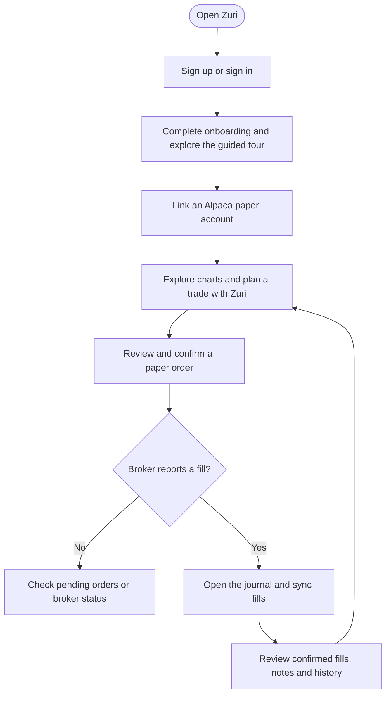
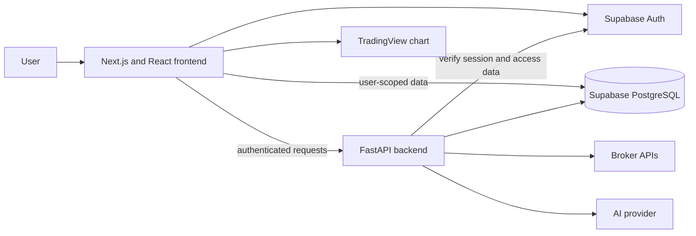
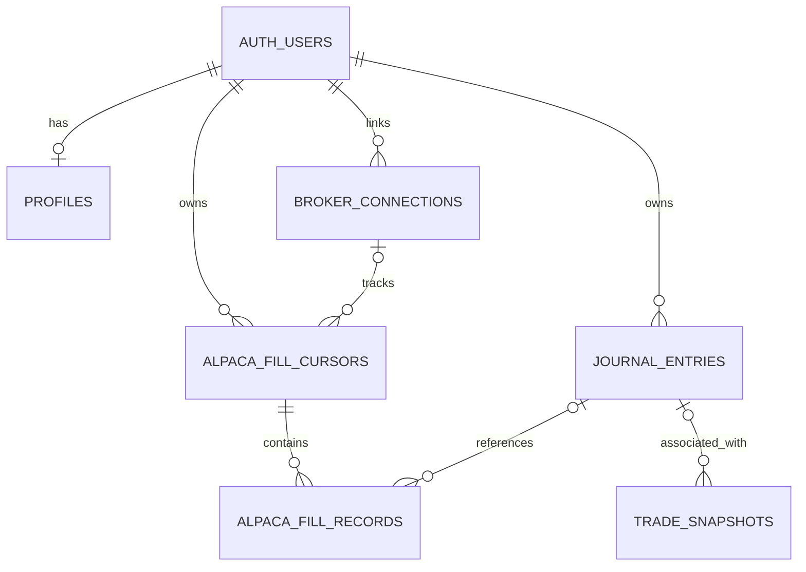

<div align="center">


</div>

---

## Table of contents

- [Project overview](#project-overview)
- [Getting started](#getting-started)
  - [Prerequisites](#prerequisites)
  - [Install and run locally](#how-to-install-and-run-locally)
  - [Google sign-in (optional)](#google-sign-in-optional)
- [Project features](#project-features)
- [Development process](#development-process)
  - [Creative direction and theme](#creative-direction-and-theme)
  - [Technical decisions](#technical-decisions)
  - [User flow](#user-flow)
  - [System structure](#system-structure)
  - [Core data relationships](#core-data-relationships)
  - [Alpaca paper fill tracking](#alpaca-paper-fill-tracking)
- [Final outcome](#final-outcome)
- [Conclusion](#conclusion)
- [License, contact and acknowledgments](#license-contact-and-acknowledgments)

---

## Project overview

**An AI-guided trading desk that teaches new traders by doing: paper-trade first, journal everything, learn from your own habits.**


Zuri Markets is a financial-literacy workspace for new and developing traders. Its AI guide helps users explore charts, practise with a paper account, and learn from their trading journal. Experienced traders can also use its trade ticket and research tools.

- **Practice first:** onboarding encourages paper trading; live orders require extra confirmation.
- **User-controlled trading:** Zuri can explain and propose trades, but the user confirms each order.
- **Learning through review:** the journal supports confirmed Alpaca paper fills, while older automatic records remain unverified. See [fill tracking](#alpaca-paper-fill-tracking) for limitations.
- **Private by design:** user data is protected by Supabase row-level security, and broker credentials are encrypted.

## Getting started

**Use Zuri online:** Open [zuri-markets.vercel.app](https://zuri-markets.vercel.app), create an account or sign in, and follow the onboarding guide. To practise trading, link your own Alpaca paper account in **Settings → Broker**. No local installation is required.

To develop or run your own copy, follow the two sections below. The frontend and backend run locally, while Supabase provides the database and authentication.

### Prerequisites

| What you need | How to get it |
|---|---|
| **Git** | Install [Git](https://git-scm.com/downloads) to clone the repository. |
| **Node.js and npm** | Install [Node.js](https://nodejs.org/en/download) 20.9 or newer; npm is included. Check with `node --version` and `npm --version`. |
| **Python and pip** | Install [Python](https://www.python.org/downloads/) 3.11 or newer. On Windows, enable **Add Python to PATH** during installation. Check with `python --version` and `python -m pip --version`. |
| **Supabase project** | Create a project in the [Supabase dashboard](https://supabase.com/dashboard). In **Project Settings → API**, find its URL, publishable/anon key, and secret `service_role` key. The service role key is for the backend only. Use a separate development project, not the live database. |
| **Groq API key** | Create a key in the [Groq console](https://console.groq.com/keys) for Zuri's AI features. |
| **Alpaca paper account** | Create an [Alpaca account](https://alpaca.markets/), open its paper-trading dashboard and generate paper API keys. These are needed for paper orders, not for installing the app; link them in Zuri rather than sharing them. |
| **Application packages** | Install Python packages from [`backend/requirements.txt`](./backend/requirements.txt) and frontend packages from [`frontend/package-lock.json`](./frontend/package-lock.json) using the commands below. |

Optional: configure [Google sign-in](#google-sign-in-optional) if you want it, and see [fill tracking](#alpaca-paper-fill-tracking) before enabling confirmed-fill reconciliation. Third-party services may have usage limits or costs.

### How to install and run locally

1. **Clone the repository** in a terminal:

   ```bash
   git clone https://github.com/Dhiali/Zuri.git
   cd Zuri
   ```

2. **Set up Supabase.** In your development project's SQL Editor, run every file in [`supabase/migrations/`](./supabase/migrations) once, in timestamp order. Do not rerun already-applied migrations. Enable the Email provider under **Authentication**; set the Site URL to `http://localhost:3000` and allow both localhost and `127.0.0.1` URLs, including their `/email-verified` paths. For branded emails, configure the [confirmation](./frontend/email-templates/confirm-signup.html), [magic link](./frontend/email-templates/magic-link.html), and [reset password](./frontend/email-templates/reset-password.html) templates in Supabase; preserve their template placeholders. See [Google sign-in](#google-sign-in-optional) for optional OAuth setup.

3. **Set up the backend** from the repository root:

   <details open>
   <summary>Windows PowerShell</summary>

   ```powershell
   python -m venv backend\venv
   backend\venv\Scripts\python.exe -m pip install -r backend\requirements.txt
   Copy-Item backend\.env.example backend\.env
   backend\venv\Scripts\python.exe -c "from cryptography.fernet import Fernet; print(Fernet.generate_key().decode())"
   ```
   </details>

   <details>
   <summary>macOS / Linux</summary>

   ```bash
   python3 -m venv backend/venv
   backend/venv/bin/python -m pip install -r backend/requirements.txt
   cp backend/.env.example backend/.env
   backend/venv/bin/python -c "from cryptography.fernet import Fernet; print(Fernet.generate_key().decode())"
   ```
   </details>

   Edit `backend/.env`: set `SUPABASE_URL`, `SUPABASE_ANON_KEY`, `SUPABASE_SERVICE_ROLE_KEY`, `GROQ_API_KEY`, and `BROKER_ENCRYPTION_KEY` to the generated key. Back up the encryption key securely: changing it makes stored broker credentials unreadable. Never commit or share the `.env` file.

4. **Set up the frontend** in a second terminal:

   ```bash
   cd Zuri/frontend
   npm ci
   ```

   Copy `frontend/.env.example` to `frontend/.env.local` (`Copy-Item .env.example .env.local` in PowerShell, or `cp .env.example .env.local` on macOS/Linux, while in `frontend`). Set `NEXT_PUBLIC_SUPABASE_URL` and `NEXT_PUBLIC_SUPABASE_ANON_KEY` to the same development project, and leave `NEXT_PUBLIC_BACKEND_URL=http://127.0.0.1:8000` for local use. Never put the service role key in a `NEXT_PUBLIC_` variable.

5. **Start both services.** From the repository root, start the backend:

   ```powershell
   # Windows PowerShell
   backend\venv\Scripts\python.exe -m uvicorn backend.main:app --host 127.0.0.1 --port 8000 --reload
   ```

   ```bash
   # macOS / Linux
   backend/venv/bin/python -m uvicorn backend.main:app --host 127.0.0.1 --port 8000 --reload
   ```

   In the frontend terminal, run `npm run dev`. Open [http://localhost:3000](http://localhost:3000); the backend API docs are at [http://127.0.0.1:8000/docs](http://127.0.0.1:8000/docs). Sign up, confirm your email, and link paper keys to try a practice trade.

   If you are working from an in-progress Git merge, resolve its conflicts before starting the backend. See [`backend/.env.example`](./backend/.env.example) and [`frontend/.env.example`](./frontend/.env.example) for additional configuration.

### Google sign-in (optional)

In the [Google Cloud Console](https://console.cloud.google.com/), create a web application OAuth client. Add `http://localhost:3000` and `http://127.0.0.1:3000` as authorised JavaScript origins and the callback URL shown by Supabase as an authorised redirect URI. Enter the client ID and secret in the Supabase Google provider settings.

---

## Project features

The mockup briefs below describe the screens to add to this showcase. Use fictional account details and hide personal information and broker credentials.

### Guided onboarding

Zuri welcomes new users, learns their experience and goals, and guides them through the workspace and paper-broker setup. A first-trade coach tracks their progress.

**Mockup to create:** The "Meet Zuri" conversation alongside an onboarding progress indicator or a highlighted step in the guided tour.

### Dashboard and learning

The dashboard brings together account information, trading activity, a suggested next step and learning resources tailored to the user's experience.

**Mockup to create:** The dashboard with paper-account balance cards, a weekly activity summary, Zuri's next-step card and a learning resource.

### Charts and market research

Users can explore TradingView charts, manage a watchlist and read market news. They can also create scanners and review historical signals using broker candle data.

**Mockup to create:** The charts workspace showing a price chart, watchlist, timeframe controls and market-news or scanner panel. Label delayed quotes where appropriate.

### Paper trading and order management

The trade ticket lets users select a symbol, side and quantity, review estimated value, and confirm a market order. The workspace also displays pending orders and open positions. Alpaca paper trading supports practice without real funds; live accounts require an additional confirmation phrase.

**Mockup to create:** The trade screen with an **Alpaca paper** badge, a filled-in order ticket, confirmation checkbox, pending orders and open positions.

### Journal, history and insights

The journal combines personal notes with automatic records and, when configured, confirmed Alpaca paper fills. Users can sync fills, analyse their journey and review trade history and chart snapshots. Older automatic records may be unverified; see [fill tracking](#alpaca-paper-fill-tracking).

**Mockup to create:** The journal showing a clearly labelled confirmed paper fill, **Sync journal**, an insights summary and a trade note or snapshot.

### Zuri AI companion

Zuri answers questions, explains trading concepts and helps users think through trade plans. It can propose actions, but users remain responsible for confirming orders.

**Mockup to create:** The Zuri AI chat panel over the workspace, showing a short question about risk and an educational response.

### Broker and account settings

Users can link or disconnect supported broker accounts, adjust trading and risk preferences, and manage account settings. Broker credentials are encrypted before storage.

**Mockup to create:** The Broker settings screen showing a connected paper account and its status; do not show API keys, account numbers or other personal data.

## Development process

Zuri brings trading tools and education into one workspace. The design combines a familiar trading-desk layout with guidance for users who may be unfamiliar with markets. The following sections explain the creative and technical choices represented in the current MVP.

### Creative direction and theme

- **A focused trading desk:** Dark backgrounds, raised panels and subdued borders separate the chart, order ticket and journal without competing with market data. The layout keeps navigation and frequently used tools visible.
- **Meaningful colour:** Green and red distinguish market movements and trade actions, yellow highlights warnings, and purple identifies Zuri's AI guidance. Labels accompany colour so important information is not conveyed by colour alone.
- **A supportive guide:** Zuri's conversational interface, guided tour and first-trade coach place explanations beside the task being performed rather than in a separate manual. Users can choose how much guidance they need.
- **Practice before risk:** Paper-account onboarding, visible account-mode labels and explicit order confirmation make the distinction between practice and live trading clear. Estimates and unverified journal records are labelled rather than presented as confirmed results.

### Technical decisions

| Decision | Approach | Why it matters |
|---|---|---|
| **Interactive workspace** | Next.js and React render the chart, trade ticket, journal and assistant. | Keeps the main activities together in one browser-based interface. |
| **Backend boundaries** | FastAPI handles broker adapters, AI requests and operations requiring server-side credentials. | Broker secrets and service-role access stay on the backend rather than in the browser. |
| **Accounts and data** | Supabase Auth and PostgreSQL provide sessions and per-user storage, with row-level security for browser-accessible data. | Users can return to their own preferences, journal and journey across sessions. |
| **Broker integration** | Broker-specific adapters translate account and trading operations to the relevant API. | The rest of the application can work with a common interface while respecting broker differences. |
| **AI with user control** | Zuri explains and proposes; the user reviews and confirms an order. | Guidance supports learning without submitting trades independently. |
| **Fill-aware journaling** | When enabled, Alpaca paper sync records confirmed fill activities separately from legacy automatic entries. | A submitted order is not assumed to be a completed fill. See [fill tracking](#alpaca-paper-fill-tracking) for setup and limitations. |

### User flow



The confirmed-fill path shown here applies to configured Alpaca paper accounts; older automatic records may not represent fills.

### System structure



The frontend accesses the user's own Supabase data under row-level security. The backend verifies sessions and handles broker credentials and AI integrations.

### Core data relationships

This simplified ERD focuses on the paper-trading and journal flow; it does not show every table.



Fill cursors retain their account checkpoint if a broker connection is disconnected; fill records can retain a null journal reference if an entry is deleted. Journal entries and snapshots also belong to a user.

### Alpaca paper fill tracking

`ALPACA_CONFIRMED_FILL_JOURNAL=true` switches Alpaca paper accounts from legacy order and position capture to confirmed-fill journal sync. It defaults to false. Apply the fill migration and deploy the compatible frontend before enabling it; validate the broker-to-database flow and monitoring first. Confirmed-fill snapshots and trade-level outcome analytics are not yet integrated. Other brokers and live accounts retain legacy capture.

Each partial fill creates a separate journal entry; buy or sell does not indicate whether a position was opened or closed. The first cursor starts at the migration or account-link/change time, so earlier fills are not imported. Reconnecting the same account resumes its checkpoint. This cutoff can overlap older, unverified records, which are preserved. The journal counts confirmed fills among the latest 500 entries, so older or deleted entries may be missing. Use **Sync journal** again if a backlog is reported, and check broker history before relying on legacy records.

For a dedicated paper-only staging environment, `ZURI_PAPER_ONLY=true` restricts broker access and new connections to Alpaca paper accounts and enables confirmed-fill sync. Existing unsupported accounts can be disconnected but not used. New orders require an available fill cursor; if storage or the migration is unavailable, the order is not submitted. This switch defaults to false; do not enable it on an existing live environment without a rollout plan.

The protected reconciliation endpoint requires a server-only `ALPACA_FILL_RECONCILIATION_SECRET` of at least 32 bytes. [`supabase/paper_fill_scheduler.sql`](./supabase/paper_fill_scheduler.sql) is an opt-in setup script, not a migration or an active schedule. It requires Supabase Vault, `pg_net`, Vault secrets named `zuri_fill_backend_url` (HTTPS origin only) and `zuri_fill_reconciliation_secret` (matching the backend secret), and a separately configured `pg_cron` job. Dispatch is limited to ten accounts per run; pending requests are not repeated for three minutes, after which missing responses are retried. The service-only dispatch table reports the most recent response or failure, and `cron.job_run_details` reports job failures. `pg_net` queues requests asynchronously and its queue can expose decrypted authorization headers to database roles: audit and restrict database access before use. Queues and responses are unlogged and responses expire, so monitoring and periodic retries remain necessary.

**Do not enable the scheduler yet.** Resolve remaining legacy-capture and end-to-end validation gaps before scheduling or releasing it. Background reconciliation is not configured in the live deployment; manual journal sync was verified for one paper fill.

`backend.test_fill_integration` is an opt-in integration test for a disposable Docker container labelled `zuri.fill.integration=disposable`, with an isolated `zuri_fill_integration` database containing the initial, broker, journey-event and fill migrations. Set `ZURI_FILL_TEST_CONTAINER` to that container ID to run it. The test uses simulated Alpaca responses and a PostgreSQL-backed storage adapter, not Alpaca or PostgREST; it checks pending orders, partial fills and recovery after a committed response is lost. Never point it at a persistent database: it deletes its fixed test user.


---

## Final outcome

Zuri is available at [zuri-markets.vercel.app](https://zuri-markets.vercel.app). The MVP brings together guided onboarding, paper trading, market research, journaling and an AI companion.

### Test results and coverage

The following results were recorded on **10 November 2026** for the local code, including a disposable PostgreSQL fill-ledger integration test:

| Check | Result | What it covers |
|---|---|---|
| Backend tests | **170 passed**, including the fill integration test; **36 subtests passed** | Authentication, broker logic, journal and fill tracking, and AI-agent behaviour. External broker responses are simulated in the integration test. |
| Frontend tests | **12 passed** | Journal sync parsing, password recovery and setup, snapshot capture behaviour, and Zuri's visual interactions. |
| Frontend quality | **ESLint, TypeScript and production build passed** | Static checks and a production build of the frontend. |
| Live paper-trading check | **Passed for one test order** | An Alpaca paper order was placed, filled and displayed as a confirmed journal entry after syncing. |

These are test results, **not a measured code-coverage percentage**. They do not establish that every feature, broker or new-user registration flow has been tested.

To rerun the backend unit tests from the repository root, use the virtual environment created above:

```powershell
# Windows PowerShell
backend\venv\Scripts\python.exe -m unittest backend.test_zuri_agent backend.test_main backend.test_fill_tracking
```

```bash
# macOS / Linux
backend/venv/bin/python -m unittest backend.test_zuri_agent backend.test_main backend.test_fill_tracking
```

For frontend checks:

```bash
cd frontend
npm run lint
npx tsc --noEmit
node --test
npm run build
```

The PostgreSQL fill integration test is opt-in and requires a disposable Docker database; see [fill tracking](#alpaca-paper-fill-tracking).

### Demo video

The demo video is **coming soon**. Its link will be added here when available; the planned walkthrough covers sign-in, the dashboard, paper trading, the journal and Zuri AI.

## Conclusion

Zuri demonstrates how an educational trading workspace can combine practice, reflection and AI guidance without removing the user's control over orders.

### Highlights

- **A connected learning journey:** onboarding, charts, a paper-trading ticket and a journal bring learning into the same workspace as practice.
- **A verified paper-trade flow:** one live Alpaca paper order was placed, filled and displayed in the journal after syncing.
- **Guidance with user control:** Zuri can explain concepts and suggest plans, while order submission requires the user's confirmation.

### Challenges and responses

| Challenge | Response and current status |
|---|---|
| Making trading approachable for beginners | Added guided onboarding, paper-account setup and contextual AI explanations. Further usability testing is needed. |
| Keeping journal records accurate | Added confirmed Alpaca paper-fill syncing and labelled older automatic records as unverified. Background reconciliation and complete trade-level analytics remain future work. |
| Protecting accounts and broker credentials | Used per-user access controls, server-side credential encryption and explicit order confirmation. Further deployment hardening and monitoring are needed. |
| Working across external services | Separated broker and AI integrations behind the backend and tested key flows with simulated responses and a live paper order. Other broker integrations still need end-to-end verification. |

### Future plans and improvements

- Complete and monitor background fill reconciliation, and connect confirmed fills to snapshots and trade-level insights.
- Expand end-to-end testing, including new-user registration, other brokers and orders queued outside market hours.
- Strengthen production readiness with monitoring, rate limiting, tighter security policies and a repeatable staging-to-production release process.
- Improve learning guidance and accessibility using feedback from real users.
- Explore background scanner alerts and improve the clarity of estimated versus confirmed results.

**Current limitations:** OANDA and Tradier have not been verified end to end with real keys. Queued stock orders have not been observed filling at market open. Quotes can be delayed, historical reviews are not simulated fills, and scanners run only while the app is open. Legacy journal records can represent unfilled orders, and journal estimates can differ from broker history. News-feed commercial permissions have not been confirmed. Zuri is educational software, not financial advice.

## License, contact and acknowledgments

**Copyright © 2026 Dhiali. All rights reserved.** No permission to use, copy, modify or distribute this project is granted by this notice.

**Contact:** [Dhiali on GitHub](https://github.com/Dhiali)

**Acknowledgments:** Thank you to Tsungai Katsuro and William Basson, the Stack Overflow community, and the teams behind Gemini and GitHub Copilot for their support and resources during Zuri's development.
